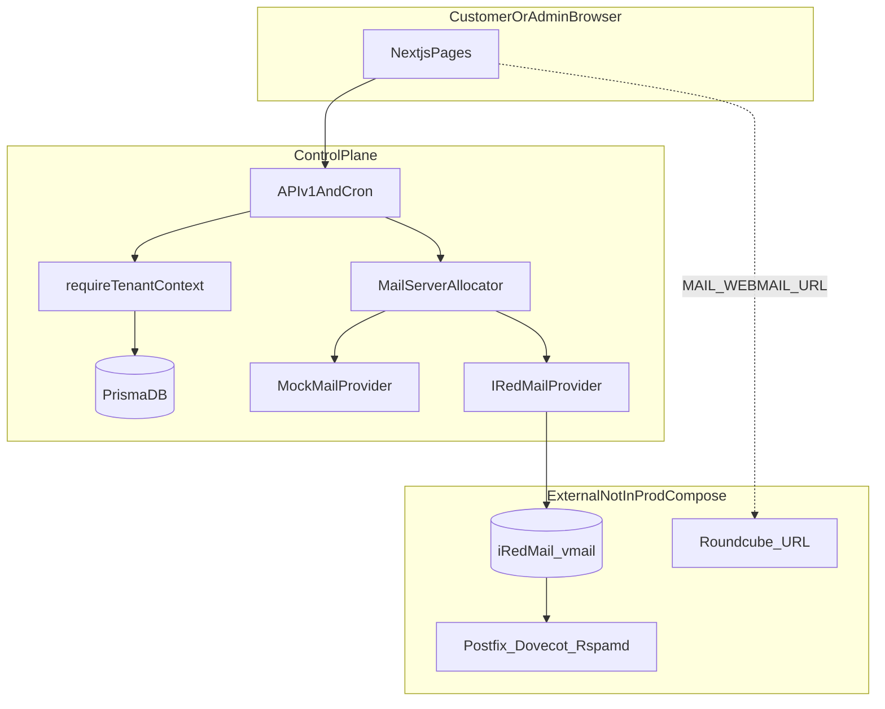

# Monogram Mail (mailoo) — Comprehensive Codebase Audit

**Audit date:** 2026-10-29  
**Repository path:** `/Users/guteng/Downloads/mailoo`  
**Product name:** Monogram Mail (`mailoo-email-hosting-saas` v1.0.0)  
**Auditor role:** Read-only static analysis, local test execution, configuration review  

**Verification legend**

| Tag | Meaning |
|-----|---------|
| **Code** | Confirmed by reading source |
| **Test** | Confirmed by automated test in this environment |
| **Config** | Inferred from deployment/config files only |
| **Not verified** | Requires live infrastructure or runtime you did not provide |

---

## 1. Executive summary

Monogram Mail is a **multi-tenant SaaS control plane** built with **Next.js 15**, **Prisma**, and a **MailProvider abstraction** that can provision domains and mailboxes against an **iRedMail `vmail` database** or an in-memory **MockMailProvider**. The customer portal, super-admin console, DNS verification, billing hooks, audit logging, and support tickets are **substantially implemented in code**.

However, the repository **does not deploy a complete mail stack** (Postfix, Dovecot, Rspamd, Roundcube). Production Docker Compose runs only the web app, PostgreSQL, Redis, and Nginx. Default development configuration uses **`MAIL_PROVIDER=mock`**. Built-in webmail is a **database-simulated** experience (`WebmailMessage`), not IMAP. Transactional email (`sendEmail`) **logs to stdout** rather than sending SMTP. Several admin operational features (backups, mail logs, abuse center UI) are **mock or UI-only**.

**Security blockers** include **unauthenticated or weakly authenticated payment webhooks** (AzamPay; optional Stripe signature verification), **optional cron authentication**, mock payment paths that activate subscriptions without payment, and **no `.gitignore`** with a local `.env` and `prisma/dev.db` present in the workspace.

**Readiness classification:** **Development-ready control plane; private beta of the portal only.** Not **production-ready** for commercial email hosting until a real mail node is integrated end-to-end, payment webhooks are hardened, and simulated subsystems are replaced or clearly disabled in production.

**Unrelated artifact:** The nested `Prayer Warriors/` project is a separate application; it pollutes `npm test` (Vitest discovers its tests). It is not part of Monogram Mail product scope.

---

## 2. Existing technology stack

| Layer | Technology | Evidence |
|-------|------------|----------|
| Frontend | Next.js 15.2 App Router, React 19, Tailwind CSS | `package.json`, `src/app/` |
| Backend | Next.js Route Handlers (`src/app/api/**/route.ts`) | 52 API route files |
| Language | TypeScript 5.8 | `tsconfig.json` |
| ORM | Prisma 6.4 | `prisma/schema.prisma` |
| Default DB (schema) | SQLite (`file:./dev.db`) | `schema.prisma` datasource |
| Production DB (compose) | PostgreSQL 16 | `docker-compose.prod.yml` |
| Auth | JWT in httpOnly cookie `monogram_session`, bcrypt (users), Dovecot `{SSHA512}` (mailboxes) | `src/lib/auth/` |
| 2FA | TOTP + backup codes | `src/lib/auth/totp.ts`, `src/app/api/v1/auth/2fa/route.ts` |
| Mail integration | `mysql2`, `pg` → iRedMail vmail SQL | `src/lib/mail/IRedMailProvider.ts` |
| Payments | Mock, Stripe REST, AzamPay MNO | `src/lib/billing/` |
| DNS | Node `dns` promises | `src/lib/dns/verifier.ts` |
| Tests | Vitest 3 | `tests/`, `vitest.config.ts` |
| Container | Multi-stage Node 20 Alpine, `output: "standalone"` | `Dockerfile`, `next.config.mjs` |
| Edge proxy | Nginx (rate limits on auth) | `nginx.conf` |

**Dependencies note:** Redis is declared in `docker-compose.prod.yml` but **no application code references Redis** (**Code**).

---

## 3. Architecture and request-flow overview



**Typical customer flow (Code):**

1. `POST /api/v1/auth/register` — creates `User`, `Organization`, trial `Subscription`, assigns mail server.
2. `POST /api/v1/domains` — allocates server, calls `MailProvider.createDomain`, stores DKIM public key in SaaS DB.
3. Customer configures DNS; `POST /api/v1/domains/[id]/verify` runs `DnsVerifier`.
4. `POST /api/v1/mailboxes` — enforces plan limits and subscription status, `createMailbox` on provider, stores hash in SaaS DB.
5. Webmail: `GET/POST /api/v1/webmail/*` reads/writes `WebmailMessage` rows (simulation), or redirects user to external Roundcube via settings.

**Session model (Code):** `requireTenantContext()` loads the authenticated user and resolves organization from **first** `OrganizationMember` (or `session.organizationId` for `SUPER_ADMIN`). Client-supplied organization IDs are not used for authorization on tenant routes.

---

## 4. Feature inventory

States: **Implemented** | **Partial** | **Mock / UI-only** | **Missing**

### 4.1 Customer-facing platform

| Feature | State | Location / notes |
|---------|-------|------------------|
| Registration | **Implemented** | `src/app/api/v1/auth/register/route.ts`, `src/app/(auth)/register/page.tsx` |
| Login / logout | **Implemented** | `auth/login`, `auth/logout`; cookie flags in login route |
| Password forgot / reset | **Partial** | `auth/forgot-password`, `auth/reset-password`; email via `sendEmail` (**Mock** delivery) |
| Email verification | **Partial** | `auth/verify-email`, `auth/resend-verification`; **not enforced at login** |
| 2FA | **Implemented** | `auth/2fa`, login challenge |
| Customer dashboard | **Implemented** | `(customer)/dashboard/page.tsx` |
| Onboarding wizard | **Implemented** | `(customer)/onboarding/page.tsx` |
| Profile / settings | **Implemented** | `(customer)/settings/page.tsx`, `auth/me` |
| Domain add / list / delete | **Implemented** | `api/v1/domains`, `(customer)/domains` |
| DNS instructions | **Implemented** | Returned on domain create; `(customer)/dns-setup` |
| Live DNS verify (MX, SPF, DKIM, DMARC) | **Implemented** | `lib/dns/verifier.ts`, `domains/[id]/verify`; **Test** `tests/dns.test.ts` |
| Mailbox create / list / update / delete | **Implemented** | `api/v1/mailboxes*`; syncs provider on suspend/activate |
| Mailbox password reset | **Implemented** | `mailboxes/[id]/reset-password`; updates provider |
| Auto-responder | **Partial** | Stored in SaaS DB (`Mailbox` fields); **no MailProvider sync found** |
| Aliases | **Implemented** | `api/v1/aliases`; plan limits |
| Forwarders | **Implemented** | `api/v1/forwarders`; plan limits |
| Catch-all | **Partial** | `domains/[id]` PATCH stores `catchAllMailboxId`; **not synced to iRedMail** |
| Quotas / usage display | **Partial** | `usage/route.ts`, cron `quota-sync`; mock usage when provider is mock |
| Subscription / billing UI | **Implemented** | `(customer)/billing/page.tsx` |
| Checkout / plan upgrade | **Partial** | Mock activates immediately; Stripe/AzamPay real paths exist |
| Invoices list | **Implemented** | `billing/invoices` |
| Support tickets | **Implemented** | `support/tickets*` |
| Domain purchase / registrar | **Mock** | `lib/registrar/MockRegistrarProvider.ts`, admin domain-registrar |
| Signatures | **Partial** | `(customer)/signatures/page.tsx` — client-side; uses mailbox list API only |
| Notifications email | **Mock** | `lib/notifications/email.ts` logs only |

### 4.2 Webmail

| Feature | State | Location / notes |
|---------|-------|------------------|
| Built-in webmail UI | **Partial / simulated** | `(customer)/webmail/page.tsx` — rich UI |
| Message storage | **Mock** | Prisma `WebmailMessage`; not maildir/IMAP |
| Compose / send | **Partial** | `webmail/messages` POST — local delivery between SaaS mailboxes; external calls `sendEmail` (**log only**) |
| Starter seed emails | **Mock** | `webmail/mailboxes/route.ts` `seedStarterEmails()` on first open |
| IMAP / SMTP for clients | **Missing in app** | Hostnames in settings/README; requires external mail server |
| Roundcube / SOGo | **Redirect only** | `MAIL_WEBMAIL_URL`, link in webmail page — **no SSO** in repo |
| Attachments | **UI-level** | Verify client behavior; not audited as real MIME storage |
| Contacts / global address book | **Missing** | Not in schema |

### 4.3 Administration

| Feature | State | Location / notes |
|---------|-------|------------------|
| Super admin dashboard | **Implemented** | `(admin)/admin/page.tsx`, `admin/overview` |
| Customer org management | **Partial** | `admin/customers` — suspend updates DB only, **no mail provider suspend** |
| User admin | **Implemented** | `admin/users*` |
| Mail server nodes | **Implemented** | `admin/servers`; health via TCP + vmail DB ping |
| Platform settings | **Implemented** | `admin/settings`, `SystemSetting` table |
| Payment gateway config | **Implemented** | `admin/payment-gateways` |
| Audit logs | **Implemented** | `admin/logs`, `lib/audit/index.ts` |
| Support tickets (staff) | **Implemented** | `(admin)/admin/tickets`, ticket APIs with staff flag |
| Health / RBL / PTR | **Partial** | `admin/health`, `admin/health/rbl` — live DNS when IP configured |
| Email logs | **Mock** | `admin/email-logs/route.ts` hardcoded array |
| Backups | **Mock** | `admin/backups/route.ts` in-memory `mockBackups` |
| Abuse center | **Mock / UI-only** | `(admin)/admin/abuse/page.tsx` — `mockIncidents`, form does not call API |
| Domain registrar admin | **Mock** | Generic/mock registrar providers |

### 4.4 API route authorization matrix

| Route | Methods | Auth | Tenant scope |
|-------|---------|------|--------------|
| `/api/health` | GET | Public | N/A |
| `/api/v1/docs` | GET | Public | OpenAPI spec |
| `/api/v1/auth/register` | POST | Public | N/A |
| `/api/v1/auth/login` | POST | Public | N/A |
| `/api/v1/auth/logout` | POST | Cookie | N/A |
| `/api/v1/auth/forgot-password` | POST | Public | N/A |
| `/api/v1/auth/reset-password` | POST | Public | Token |
| `/api/v1/auth/verify-email` | POST | Token | N/A |
| `/api/v1/auth/resend-verification` | POST | Session | N/A |
| `/api/v1/auth/me` | GET, PATCH | Session / tenant | User + org |
| `/api/v1/auth/sessions` | GET, DELETE | Tenant | User sessions |
| `/api/v1/auth/2fa` | GET, POST, DELETE | Tenant | User |
| `/api/v1/domains` | GET, POST | Tenant | `organization.id` |
| `/api/v1/domains/[id]` | GET, PATCH, DELETE | Tenant | Org + domain |
| `/api/v1/domains/[id]/verify` | POST | Tenant | Org + domain |
| `/api/v1/mailboxes` | GET, POST | Tenant | Org; plan limits on POST |
| `/api/v1/mailboxes/[id]` | GET, PATCH, DELETE | Tenant | Org; provider sync |
| `/api/v1/mailboxes/[id]/reset-password` | POST | Tenant | Org |
| `/api/v1/mailboxes/[id]/auto-responder` | GET, PATCH | Tenant | Org |
| `/api/v1/aliases` | GET, POST, DELETE | Tenant | Org |
| `/api/v1/forwarders` | GET, POST, DELETE | Tenant | Org |
| `/api/v1/usage` | GET | Tenant | Org |
| `/api/v1/webmail/mailboxes` | GET | Tenant | Org |
| `/api/v1/webmail/messages` | GET, POST | Tenant | Org + mailboxId |
| `/api/v1/webmail/messages/[id]` | GET, PATCH, DELETE | Tenant | Org via message |
| `/api/v1/billing/subscription` | GET | Tenant | Org |
| `/api/v1/billing/invoices` | GET | Tenant | Org |
| `/api/v1/billing/checkout` | POST | Tenant | Org |
| `/api/v1/billing/portal` | POST | Tenant | Stripe or mock URL |
| `/api/v1/billing/webhook` | POST | **Unauthenticated** | Stripe events |
| `/api/v1/billing/webhook/azampay` | POST | **Unauthenticated** | AzamPay callback |
| `/api/v1/support/tickets` | GET, POST | Tenant | Org |
| `/api/v1/support/tickets/[id]` | GET, PATCH | Tenant / super admin | Ticket org check |
| `/api/v1/support/tickets/[id]/reply` | POST | Tenant / super admin | Ticket org check |
| `/api/v1/admin/*` | Various | **Super admin** | Platform-wide |
| `/api/cron/quota-sync` | POST | Bearer `CRON_SECRET` if set | **Open if secret unset** |
| `/api/cron/dns-check` | POST | Same as cron | **Open if secret unset** |

---

## 5. Email infrastructure assessment

### 5.1 Does this operate real email today?

| Question | Answer | Evidence |
|----------|--------|----------|
| Mail server in repo deploy? | **No** | `docker-compose.prod.yml` has no Postfix/Dovecot |
| Default provider | **Mock** | `.env.example` `MAIL_PROVIDER="mock"` |
| Can provision real mailboxes? | **Only if** `MAIL_PROVIDER=iredmail` and vmail DB reachable | `IRedMailProvider` |
| Inbound SMTP / queue | **Not in app** | Requires iRedMail host |
| Outbound from built-in webmail | **Simulated / log** | `webmail/messages/route.ts`, `sendEmail` |
| Webmail | **Simulated + external URL** | `WebmailMessage` vs `MAIL_WEBMAIL_URL` |
| SPF/DKIM/DMARC for customers | **DNS verify only** | SaaS generates DKIM TXT; signing on server **not wired** |
| DKIM private key on mail node | **Missing** | `getOrCreateDkimRecord` generates keys; `dkimPrivateKeyEncrypted` unused in domain create |
| Quota from Dovecot | **When iredmail** | Reads `used_quota` table |
| Domain before DNS verify | **Provisioned immediately** | `domains/route.ts` calls `createDomain` before verification |
| DB vs mail server drift | **Risk** | SaaS DB is source for UI; iRedMail updated via provider calls — failures leave partial state |
| Staging vmail DB only | **MariaDB compose** | `docker-compose.iredmail-staging.yml` — **no mail daemon**, port 3306 published |

### 5.2 iRedMail integration (Code)

`IRedMailProvider` performs parameterized SQL against `domain`, `mailbox`, `alias`, `forwardings`, `used_quota`. Health check: SQL `SELECT 1` plus TCP connect to configured SMTP/IMAP hosts (`checkServerHealth`).

**Not verified in this audit:** Actual delivery, Rspamd, TLS certs, PTR, port 25 reachability, or Roundcube login with provisioned passwords.

### 5.3 DNS cron bug (Code)

`POST /api/cron/dns-check` loads domains with `status: "ACTIVE"`, but new domains are created as `PENDING_VERIFICATION`. Scheduled re-checks likely **skip most domains** until status is manually changed.

---

## 6. Security findings (ranked by severity)

| ID | Severity | Finding | Location | Impact | Exploit conditions | Remediation | Confirmed |
|----|----------|---------|----------|--------|-------------------|-------------|-----------|
| SEC-01 | **Critical** | AzamPay webhook has no signature or shared-secret verification; trusts JSON body | `src/app/api/v1/billing/webhook/azampay/route.ts` | Free subscription activation, invoice fraud | Attacker POSTs fake `success` with guessed UUID `organizationId` / `planId` | Implement AzamPay callback verification per official docs; idempotency on `transactionId`; reject unsigned callbacks | **Code** |
| SEC-02 | **High** | Stripe webhook skips signature verification when `STRIPE_WEBHOOK_SECRET` unset | `src/app/api/v1/billing/webhook/route.ts` | Forged checkout events activate subscriptions | Webhook URL exposed without secret configured | Require secret in production; reject if missing; use Stripe SDK constant-time verify | **Code** |
| SEC-03 | **High** | Cron endpoints authenticated only if `CRON_SECRET` set | `src/app/api/cron/quota-sync/route.ts`, `dns-check/route.ts` | DoS, forced DNS status flips, DB churn | `CRON_SECRET` empty in deployment | Fail closed in production if secret missing; always require Bearer token | **Code** |
| SEC-04 | **High** | Mock payment and checkout mock branch set subscription `ACTIVE` without payment | `billing/checkout/route.ts`, `MockPaymentProvider` | Anyone with account upgrades for free | `PAYMENT_PROVIDER=mock` or mock branch in prod | Disable mock provider when `NODE_ENV=production`; separate demo env | **Code** |
| SEC-05 | **High** | JWT signing uses hardcoded fallback secret | `src/lib/auth/jwt.ts` | Session forgery if env not set | Deploy without `JWT_SECRET` | Crash on startup if secret missing or weak; rotate secrets | **Code** |
| SEC-06 | **High** | No `.gitignore`; `.env` and `prisma/dev.db` present locally | Repository root | Accidental commit of secrets and customer data | Git add/commit without ignore rules | Add `.gitignore`; scan history; rotate exposed credentials | **Code** (presence); git tracking **Not verified** |
| SEC-07 | **Medium** | Built-in webmail send has no rate limiting | `webmail/messages/route.ts`; `OutboundRateLimiter` unused | Spam via SaaS UI | Authenticated tenant | Call `OutboundRateLimiter.checkAndIncrement`; enforce `AbuseProtection.DAILY_OUTBOUND_LIMIT` | **Code** |
| SEC-08 | **Medium** | Org suspension does not block API mutations consistently | `admin/customers` PATCH; most tenant POST routes | Suspended customers may still create mailboxes | Org marked SUSPENDED in DB only | Check `organization.status` in `requireTenantContext` or middleware | **Code** |
| SEC-09 | **Medium** | Admin server API returns full `MailServer` records including `metadata` JSON | `admin/servers/route.ts` GET | DB credential leak to compromised admin session | Super admin token | Strip/redact `metadata` in responses; encrypt at rest | **Code** |
| SEC-10 | **Medium** | Stripe billing portal uses `organization.id` as Stripe `customer` | `billing/portal/route.ts` | Portal session creation fails or wrong mapping | Stripe enabled | Store `stripeCustomerId` on org/subscription | **Code** |
| SEC-11 | **Low** | Session JWT stored in `UserSession.sessionToken` | `auth/login/route.ts` | Replay if DB leaked | DB compromise | Store hash of token only | **Code** |
| SEC-12 | **Low** | Demo credentials in README | `README.md` | Credential stuffing in dev deployments | Public dev instance | Remove or gate demo seeds in production | **Code** |
| SEC-13 | **Info** | Security headers enabled globally | `next.config.mjs` | Baseline XSS/clickjacking hardening | N/A | Add CSP when ready | **Code** |

**Positive controls (Code):** Tenant-scoped queries on domains, mailboxes, webmail messages; `passwordHash` stripped from mailbox list API; httpOnly session cookie; nginx auth rate limit; `tests/tenant-isolation.test.ts`.

---

## 7. Multi-tenant architecture assessment

**Model:** `Organization` owns `Domain`, `Mailbox`, billing, and support data. Users link via `OrganizationMember`.

**Strengths (Code):**

- Tenant APIs derive `organizationId` from session via `requireTenantContext()`, not from request body.
- Resource lookups combine `id` with `organizationId` (e.g. mailboxes, webmail).
- Super-admin routes gated by `requireSuperAdmin()`.

**Weaknesses (Code):**

- **Single org per user session:** `memberships[0]` only — no org switcher; multi-org users ambiguous (`session.ts`, `auth/login`).
- **SUPER_ADMIN** can attach `organizationId` to JWT for tenant context — intentional for impersonation; document and audit.
- **Subscription optional checks:** Some routes allow actions when `subscription` is null (mailbox POST checks subscription only if present).
- **Organization SUSPENDED** not enforced centrally on write paths.
- **Cross-tenant mailbox email uniqueness** is global (`Mailbox.email` unique) — correct for email, but allows enumeration of provisioned addresses via 409 responses (**potential** abuse).

**Scalability:** Synchronous provider SQL per request; cron quota sync loops all orgs/mailboxes — acceptable at small scale; needs job queue for large fleets.

---

## 8. Billing and subscription assessment

| Capability | Status | Evidence |
|------------|--------|----------|
| Plans in DB | **Implemented** | `Plan`, seed data; **Test** `pages-review.test.ts` |
| Trial on register | **Implemented** | `auth/register` |
| Plan limits (domains, mailboxes, aliases) | **Partial** | Enforced on create routes; not on all operations |
| Mock checkout → ACTIVE | **Implemented** | `billing/checkout` — **must not run in prod** |
| Stripe Checkout | **Partial** | Creates session via REST; webhook updates subscription |
| Stripe webhook verification | **Partial** | Optional HMAC if secret set |
| AzamPay checkout | **Partial** | Real API + simulate self-callback |
| AzamPay webhook | **Vulnerable** | SEC-01 |
| Idempotent webhooks | **Missing** | Duplicate events may duplicate invoices |
| Grace period / auto-suspend | **Partial** | Schema has `GRACE_PERIOD`; no cron job found |
| Customer portal | **Partial** | Stripe portal likely broken (customer ID mapping) |
| Entitlements vs mail | **Partial** | Subscription status checked on mailbox create; not on send/simulated webmail |

**Conclusion:** Payment status can control **some** provisioning, but **forged webhooks and mock paths** undermine commercial trust. Frontend billing display is **not** sufficient protection.

---

## 9. VPS deployment and operational readiness

| Area | Assessment | Notes |
|------|------------|-------|
| Prod compose | **Partial** | Web + Postgres + Redis + Nginx; no certbot service; certs volume expected pre-populated |
| Prisma prod | **Gap** | Schema provider SQLite vs Postgres in compose — requires `provider = postgresql` and migrations for prod |
| Mail ports | **Not on app server** | Separate mail VPS: 25, 465, 587, 993, PTR |
| Cron scheduling | **Not bundled** | Document external scheduler + `CRON_SECRET` |
| Redis | **Unused** | Remove or implement sessions/idempotency |
| Health check | **Implemented** | `/api/health`, Docker HEALTHCHECK |
| Logging | **Partial** | `console.log` for email dispatch; no centralized log shipping in repo |
| Monitoring / mail queue | **Missing** | Mock admin email logs |
| Backups | **Mock** | No pg_dump or maildir backup automation |
| DR / restore | **Not documented** | |
| Staging MariaDB | **Risk** | Default passwords, published 3306 — dev only |
| iRedMail staging compose | **DB only** | Does not validate full mail path |

**Production configuration reference:** `.env.production.example` lists expected variables (names only; do not commit values).

---

## 10. Test results and verification limitations

### 10.1 Executed commands (2026-10-29)

```bash
npm test   # exit code 1 (see below)
npm run lint   # interactive ESLint setup prompt; no eslint config committed — not completed
```

### 10.2 `npm test` (Vitest)

| Suite | Result |
|-------|--------|
| `tests/auth.test.ts` | Pass |
| `tests/mail-provider.test.ts` | Pass |
| `tests/dns.test.ts` | Pass (live DNS to public domains) |
| `tests/tenant-isolation.test.ts` | Pass |
| `tests/e2e-journey.test.ts` | Pass |
| `tests/launch-readiness.test.ts` | Pass |
| `tests/pages-review.test.ts` | Pass |
| `Prayer Warriors/server/tests/api.test.ts` | **Fail** — DB `prayer_warriors_db` does not exist |

**Totals:** 32 passed, 13 skipped, 1 failed file (unrelated project).

### 10.3 Not verified in this environment

- Real SMTP/IMAP send/receive
- iRedMail provisioning against live vmail
- Stripe/AzamPay production webhooks
- TLS certificates and reverse DNS
- Docker production build and Nginx SSL path
- Payment card flows

---

## 11. Recommended improvements (with file references)

1. **Harden webhooks** — AzamPay and Stripe (`billing/webhook/*`); add idempotency table keyed by provider event ID.
2. **Production guardrails** — Refuse startup without `JWT_SECRET`, `CRON_SECRET`, `STRIPE_WEBHOOK_SECRET` (when Stripe enabled), and `MAIL_PROVIDER=iredmail`.
3. **Real transactional SMTP** — Implement in `lib/notifications/email.ts` (e.g. nodemailer) when `SYSTEM_SMTP_*` set.
4. **Webmail clarity** — Label built-in webmail as demo or integrate IMAP/SOGo; remove misleading seed emails or gate behind dev flag (`webmail/mailboxes/route.ts`).
5. **DKIM on mail node** — Deploy private keys to Rspamd/iRedMail; or use iRedMail-native DKIM instead of SaaS-only TXT generation (`IRedMailProvider.getOrCreateDkimRecord`).
6. **Fix DNS cron** — Query `PENDING_VERIFICATION`, `VERIFIED`, or all non-deleted domains (`cron/dns-check/route.ts`).
7. **Enforce org status and DNS** — Before mailbox create/send: `organization.status === ACTIVE'`, `domain.isVerified`.
8. **Suspend propagation** — On org suspend, call `suspendDomain` / mailboxes on provider (`admin/customers/route.ts`).
9. **Catch-all** — Sync to iRedMail alias/forwarding model (`domains/[id]/route.ts`).
10. **Abuse admin** — Wire UI to `AbuseProtection.triggerAbuseAction` (`admin/abuse/page.tsx`, `lib/abuse/index.ts`).
11. **Replace mock ops APIs** — Backups and mail logs from real Postfix/rsyslog or LMTP metrics.
12. **Repository hygiene** — Add `.gitignore`, exclude `Prayer Warriors/**` from Vitest (`vitest.config.ts`).
13. **PostgreSQL migrations** — Replace SQLite-only workflow for production (`prisma/schema.prisma`, migrations folder).

---

## 12. Prioritized implementation roadmap

### P0 — Critical security and blockers

| Item | Problem | Solution | Files | Verify |
|------|---------|----------|-------|--------|
| P0-1 | Forged AzamPay payments | Verify callbacks; idempotency | `billing/webhook/azampay/route.ts` | Send invalid signature → 401; valid test callback once only |
| P0-2 | Open Stripe webhooks | Mandatory signature | `billing/webhook/route.ts` | POST without signature → 400 in prod |
| P0-3 | Open cron | Require secret always in prod | `cron/*/route.ts` | POST without Bearer → 401 |
| P0-4 | Mock billing in prod | Hard disable mock provider | `billing/checkout/route.ts`, `PaymentProvider.ts` | Prod checkout cannot set ACTIVE without webhook |
| P0-5 | Weak JWT default | Fail startup | `lib/auth/jwt.ts`, app bootstrap | Missing `JWT_SECRET` → process exit |
| P0-6 | Secrets in VCS risk | `.gitignore`, rotation | repo root | No `.env` in git; secret scan clean |

### P1 — Required before paying customers

| Item | Problem | Solution | Files | Verify |
|------|---------|----------|-------|--------|
| P1-1 | No real mail E2E | Deploy iRedMail; set `iredmail` | README, `IRedMailProvider` | IMAP login; send/receive external mail |
| P1-2 | DKIM not signing | Install keys on Rspamd | mail node + provider | DKIM pass on mail-tester |
| P1-3 | Simulated webmail misleads | External Roundcube + docs | `webmail/*`, settings | Customer uses real IMAP inbox |
| P1-4 | Transactional email | Real SMTP send | `notifications/email.ts` | Password reset arrives in inbox |
| P1-5 | Rate limits | Wire limiter on send | `webmail/messages/route.ts`, `RateLimiter.ts` | 101st send in hour → 429 |
| P1-6 | DNS cron | Fix domain filter | `cron/dns-check/route.ts` | Pending domains re-checked nightly |
| P1-7 | Postgres prod | Migrations | `prisma/` | `docker-compose.prod.yml` bootstraps schema |
| P1-8 | Org suspend | Block API + mail | `session.ts`, `admin/customers` | Suspended org cannot POST mailbox |

### P2 — Reliability, automation, maintainability

| Item | Problem | Solution | Files | Verify |
|------|---------|----------|-------|--------|
| P2-1 | Vitest pollution | Exclude Prayer Warriors | `vitest.config.ts` | `npm test` all pass |
| P2-2 | Redis unused | Use for webhook idempotency or remove | compose + app | Duplicate webhook ignored |
| P2-3 | Mock backups/logs | Real pipelines | `admin/backups`, `admin/email-logs` | Restore test from backup |
| P2-4 | Billing lifecycle cron | Grace → suspend | new job + subscription fields | Past-due org suspended after grace |
| P2-5 | ESLint CI | Add eslint config | `eslint.config.mjs` | `npm run lint` non-interactive |
| P2-6 | Email verification gate | Require verified email | `auth/login`, sensitive routes | Unverified user blocked from billing |

### P3 — Advanced features and differentiation

| Item | Problem | Solution | Files | Verify |
|------|---------|----------|-------|--------|
| P3-1 | No Roundcube SSO | SAML/OAuth bridge | new integration | One-click webmail from portal |
| P3-2 | Multi-org users | Org switcher | `session.ts`, UI | User switches tenant safely |
| P3-3 | Real registrar | API provider | `lib/registrar/` | Domain purchase creates zone |
| P3-4 | Abuse automation | Ingest Postfix logs | new worker + admin UI | Incident from real log line |
| P3-5 | Multi-mail-server | Capacity limits enforced | `MailServerAllocator` | Second node receives new domains |

---

## 13. Questions requiring infrastructure access or business decisions

1. **Mail node:** Is iRedMail (or compatible) already deployed? Provide hostname, vmail DB connectivity (VPN/IP allowlist), and whether Roundcube is at `MAIL_WEBMAIL_URL`.
2. **DNS:** Who operates customer DNS — customers only, or managed DNS with API (Cloudflare, etc.)?
3. **Payments:** Production mix — Stripe, AzamPay, or both? Confirm AzamPay callback signing specification and production callback URL.
4. **Topology:** Single VPS vs split control-plane and mail? Where will port 25 be hosted (many cloud providers block it)?
5. **Compliance:** Data residency, retention period for mail, GDPR/export/delete requirements, and acceptable use / anti-spam policy.
6. **Branding:** Is “Monogram Mail” final? Separate webmail domain per customer or shared host?
7. **Prayer Warriors folder:** Should it be removed from this repository or moved to avoid confusion and test failures?
8. **Demo data:** Will production deployments run `prisma/seed.ts`? Seed contains known passwords (`README.md`).
9. **Currency:** AzamPay uses TZS conversion — official FX source for invoices?
10. **Backup RPO/RTO:** Target recovery objectives for SaaS DB vs maildir storage?

---

## Appendix A — UI pages (31 routes)

Public/marketing: `src/app/page.tsx`  
Auth: `(auth)/login`, `register`, `forgot-password`, `reset-password`, `verify-email`  
Customer: `dashboard`, `onboarding`, `domains`, `dns-setup`, `mailboxes`, `aliases`, `forwarders`, `usage`, `billing`, `webmail`, `signatures`, `settings`, `support`  
Admin: `admin`, `customers`, `servers`, `settings`, `payment-gateways`, `domain-registrar`, `logs`, `email-logs`, `backups`, `health`, `tickets`, `abuse`

---

## Appendix B — Environment variables (names only)

See `.env.example` and `.env.production.example` for full lists. Critical groups: `DATABASE_URL`, `JWT_SECRET`, `MAIL_PROVIDER`, `IREDMAIL_DB_*`, `MAIL_*` hostnames, `PAYMENT_PROVIDER`, `STRIPE_*`, `AZAMPAY_*`, `CRON_SECRET`, `SYSTEM_SMTP_*`.

**Do not commit live values.** A local `.env` file was present during audit (**Code**); values were not read or reproduced in this document.

---

*End of audit report.*
